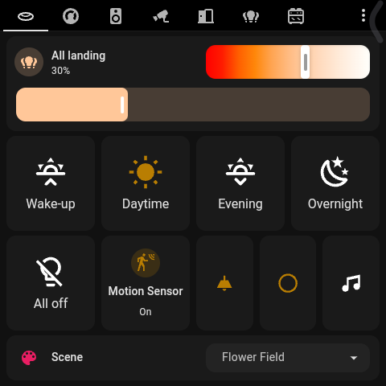
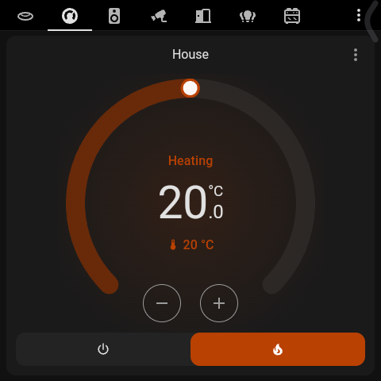
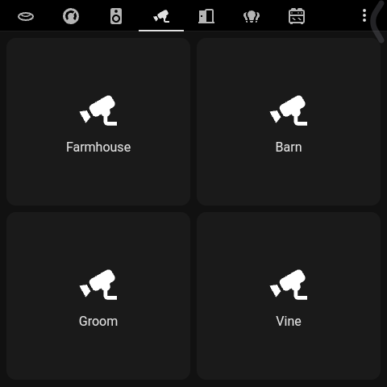

# Lite Resources

**Make Home Assistant dashboards fast on wall panels, old tablets and other low-powered screens - without changing anything for your phones and computers.**

Home Assistant sends every screen the same thing: *every* custom card you've ever installed, and a live update for *every* entity in your home, whether or not that screen shows it. A phone shrugs that off. A wall panel with a slow chip spends its life downloading JavaScript it never runs and processing updates for sensors it never displays - and you feel it as a laggy, stuttering dashboard.

Lite Resources fixes that for the users your panels log in as:

| | Without | With Lite Resources |
|---|---|---|
| Custom card files loaded at start-up | all of them (25 files, ~9 MB here) | only the ones the panel's dashboard uses (2 here) |
| Entities streamed live | every entity (2,955 here, ~28 updates a second) | only those on the panel's dashboard (89 here) |
| Your phone, tablet, desktop | unchanged | unchanged |

  
  
  
   <em>A Sonoff NSPanel Pro (480×480, Rockchip PX30) running a full Home Assistant dashboard with Lite Resources.</em>

## Who is it for?

Anyone running a Home Assistant dashboard on hardware that struggles with it. For example:

- **Sonoff NSPanel Pro** (Gen 1 / Gen 2) and other Android in-wall switch panels (Tuya, Moes, Shelly Wall Display, "86-box" panels)
- **Amazon Fire tablets** (Fire 7 / HD 8 / HD 10) used as wall dashboards
- **Old iPads and Android tablets** given a second life on the wall
- **Raspberry Pi touchscreens** running a Chromium kiosk (Pi 3, Pi Zero 2 W, older Pi 4s)
- **Echo Show / Lenovo smart displays** running a browser or Fully Kiosk
- **Old phones** used as room remotes
- Anything shown through **Fully Kiosk Browser, WallPanel, View Assist / VACA, or the Home Assistant Companion app** on a modest device

The more custom cards you have installed and the more entities your home has, the bigger the difference.

### Running View Assist / VACA?

If you use [View Assist](https://github.com/dinki/View-Assist) with the **View Assist Companion App (VACA)** on a wall tablet or panel, this is for you. VACA's screen is a Home Assistant dashboard running on the same modest hardware that's also doing wake-word detection and audio - every bit of CPU the dashboard doesn't waste is CPU the voice side gets. Point Lite Resources at the user your VACA device logs in as and its View Assist dashboard(s). Voice, timers and VACA's device controls are unaffected: they don't use the dashboard's connection.

## How it works

Nothing is changed on disk and nothing is patched in the frontend. Lite Resources answers two of the frontend's own requests differently for the users you choose:

1. **Resources** - the frontend asks once per page load for the list of dashboard resources (`lovelace/resources`). Light users get only the resources their dashboards use. Lite Resources reads those dashboards, collects every `custom:` card type (including cards inside pop-ups, stacks, conditional cards and features), and finds which resource files define them. Mods with no card type are detected from dashboard keys (`card_mod` → card-mod, `kiosk_mode` → kiosk-mode).
2. **States** (optional) - the frontend subscribes to every entity's state (`subscribe_entities`). Light users' subscription is narrowed to the entities that appear anywhere in their dashboards (cards, pop-ups, conditions, actions), plus members of any groups, plus anything you add yourself.

Everyone else gets Home Assistant's normal behaviour. Remove the integration and everything is exactly as before.

## Install

### HACS (recommended)

Or: HACS → ⋮ → **Custom repositories** → add `https://github.com/evski/ha-lite-resources` as an **Integration**. Install **Lite Resources** and restart Home Assistant.

### Manual

Copy `custom_components/lite_resources` into your `config/custom_components/` folder and restart Home Assistant.

## Set up

Or **Settings → Devices & services → Add integration → Lite Resources**.

| Option | What to choose |
|---|---|
| **Light users** | The user(s) your panels log in as. Give each panel its own Home Assistant user if it doesn't have one. |
| **Their dashboards** | Every dashboard those users open. |
| **Always include** | Resources to load regardless (e.g. a mod your theme relies on). |
| **Include resources that can't be checked** | Resources served by integrations (e.g. `/browser_mod.js`, `/webrtc/...`) can't be read. On = always load them (safe default). Off = skip them unless listed under *Always include*. |
| **Only send states their dashboards show** | Turn on for the biggest speed-up on slow devices. |
| **Extra entities** | Entities to keep streaming even though they aren't on the dashboards. |

Then reload the panel's browser/app.

### Check what a panel gets

**Developer tools → Actions → `lite_resources.preview`** lists the resources light users get and skip, any `custom:` card types no local resource was found for, and (with state filtering on) the entities they receive.

## FAQ

**Why isn't this built into Home Assistant?**
Home Assistant's frontend is designed so any screen can show anything instantly - search, more-info dialogs and templates can reach every entity without asking first. That's the right default for phones and desktops. Lite Resources is an opt-in trade-off for screens that only ever show one dashboard.

**Does it filter per device or per user?**
Per user. If you log in as a light user on your phone, you get the light behaviour there too - so give panels their own user.

**Something shows "unavailable" or a card fails to load on the panel.**
With state filtering on, entities not on the panel's dashboards aren't sent - add them under *Extra entities*, or add the dashboard. For a card that fails to load, run `lite_resources.preview` and add its resource under *Always include*.

**Does it affect voice assistants, automations, history or the companion app's sensors?**
No. Only the dashboard's resource list and its live state subscription are changed, and only for light users.

**What happens if something goes wrong?**
If working out the trimmed list fails for any reason, the full list is sent and an error is logged - a panel is never left without its cards.

## Contributing

Issues and pull requests are welcome. Please include your Home Assistant version and the output of `lite_resources.preview`.

## License

[MIT](LICENSE)
